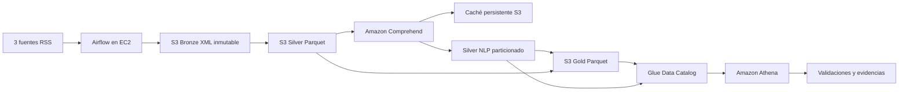

# Data Lake RSS en AWS

Integrantes:
-  Juan Nicolás Cortés 
- Juan José Ramírez

Pipeline académico de extremo a extremo para noticias RSS con arquitectura medallón en AWS. Airflow en EC2 orquesta la ingesta, transformación, enriquecimiento, publicación y validación sin intervención manual entre etapas.

## Arquitectura



Región de laboratorio: `us-east-2`. Todos los objetos viven en un único bucket. Las credenciales provienen del rol de instancia EC2; el repositorio no contiene llaves AWS, contraseñas ni archivos `.pem`.

## Componentes

- `dags/rss_pipeline.py`: DAG integral programado cada hora; admite ingesta nueva y reproceso.
- `dags/rss_lake/bronze.py`: descarga RSS, conserva originales y registra trazabilidad.
- `dags/rss_lake/silver.py`: limpieza, validación, deduplicación, versiones y cuarentena.
- `dags/rss_lake/nlp.py`: Comprehend, caché por hash de texto y tablas NLP normalizadas.
- `dags/rss_lake/gold.py`: indicadores agregados por fecha, medio, sección, entidad y frase.
- `dags/rss_lake/catalog.py`: tablas y particiones Glue, workgroup y validaciones Athena.
- `dags/rss_prepare_validation_batch.py`: crea escenarios controlados sin alterar Bronze original.
- `sql/consultas-athena.sql`: consultas solicitadas para consumo y conciliación.
- `docs/`: arquitectura, diccionario, validaciones, costos y evidencias.
- `tests/`: pruebas locales sin AWS ni HTTP real.

## Capas y publicación

Bronze conserva XML y metadatos inmutables por `batch_id`. Silver mantiene una fila vigente por `news_id`, asociaciones fuente/sección y cuarentena. El enriquecimiento publica `news_entities` y `news_key_phrases` con una fila por mención normalizada distinta. Gold materializa agregados completos por `release_id`.

Los Parquet se escriben primero en rutas inmutables. Solo después de validar todos los objetos se actualizan los punteros `control/*/current.json`. Athena consulta tablas asociadas a una única release, evitando mezclar versiones parciales.

## Despliegue resumido

1. Crear o reutilizar una EC2 Ubuntu `t3.small`, disco gp3 de 30 GiB y rol IAM de mínimo privilegio.
2. Instalar Docker y Docker Compose; construir la imagen definida por `Dockerfile`.
3. Crear `.env` a partir de `.env.example` sin confirmar secretos.
4. Copiar `dags/` a `~/data-lake/dags/` y arrancar:

```bash
cd ~/data-lake
sudo docker compose up -d
sudo docker compose ps
```

La guía completa, incluidos recursos AWS, permisos, verificación, pausa y eliminación, está en [docs/DESPLIEGUE.md](docs/DESPLIEGUE.md).

5. Abrir Airflow mediante túnel SSH, nunca exponiendo el puerto 8080 públicamente:

```powershell
ssh -i "RUTA_LLAVE.pem" -N -L 127.0.0.1:8080:127.0.0.1:8080 ubuntu@IP_ACTUAL
```

6. Ejecutar `rss_pipeline` con una de estas configuraciones:

```json
{"mode":"ingest","batch_id":"not-used","max_records":1000}
```

```json
{"mode":"reprocess","batch_id":"rss-IDENTIFICADOR","max_records":1000}
```

En `reprocess`, el pipeline lee exclusivamente los XML existentes en Bronze y no consulta los RSS.

## Orquestación

`rss_pipeline` ejecuta:

```text
validar_configuracion
-> ingerir_o_reprocesar
-> publicar_silver
-> enriquecer_nlp
-> construir_gold
-> registrar_catalogo
-> validar_athena
-> auditar_ejecucion
```

El DAG tiene programación `0 * * * *`, `max_active_runs=1`, reintentos acotados y auditorías `COMPLETE`/`FAILED`. Durante pausas del laboratorio debe permanecer desactivado.

## Pruebas

```bash
python -B -m unittest discover -s tests -v
```

Las pruebas locales no reemplazan las evidencias reales de S3, Airflow, Comprehend, Glue y Athena.

## Seguridad y costos

- IAM de mínimo privilegio y credenciales temporales del rol EC2.
- MFA en la cuenta y acceso SSH limitado a `Mi IP`.
- Airflow disponible solo mediante túnel SSH.
- Cifrado S3 administrado por AWS y escrituras condicionales para originales.
- Workgroup Athena con resultados dedicados y límite de bytes por consulta.
- Presupuesto AWS de USD 10 y EC2 detenida fuera del laboratorio.

Véase [docs/COSTOS.md](docs/COSTOS.md) para los supuestos y fórmulas.

## Eliminación o pausa

Para una pausa recuperable:

```bash
cd ~/data-lake
sudo docker compose stop
```

Después detener, no terminar, la EC2. EBS y S3 continúan almacenados y pueden generar cargos. Para eliminación definitiva, exportar evidencias, vaciar y eliminar el bucket, borrar tablas Glue, workgroup/resultados Athena, políticas/rol, instancia, volumen EBS y grupo de seguridad, verificando antes que no sean compartidos.

## Documentación

- [Arquitectura y decisiones](docs/ARQUITECTURA.md)
- [Diccionario de datos](docs/DICCIONARIO-DATOS.md)
- [Validaciones 4.5 y 4.6](docs/VALIDACIONES.md)
- [Costos](docs/COSTOS.md)
- [Índice de evidencias](docs/EVIDENCIAS.md)
- [Despliegue reproducible](docs/DESPLIEGUE.md)
- [Demostración documentada](docs/DEMOSTRACION.md)

## Demostración respaldada por evidencias

La ingesta completa, las consultas en Athena, el reproceso idempotente, el fallo controlado, la recuperación y la limitación de Comprehend están reunidos en [docs/DEMOSTRACION.md](docs/DEMOSTRACION.md). Las capturas corresponden a ejecuciones reales y cada escenario se puede repetir mediante el DAG `rss_pipeline`.

