# Demostración documentada

Esta guía reúne la evidencia de los pasos solicitados para demostrar el pipeline. Las capturas corresponden a ejecuciones reales en AWS y el código reproducible se encuentra en el repositorio.

## 1. Ingesta completa de extremo a extremo

El DAG integral ejecuta validación, ingesta Bronze, publicación Silver, enriquecimiento con Comprehend, construcción Gold, registro del catálogo, validaciones Athena y auditoría final sin intervención manual.

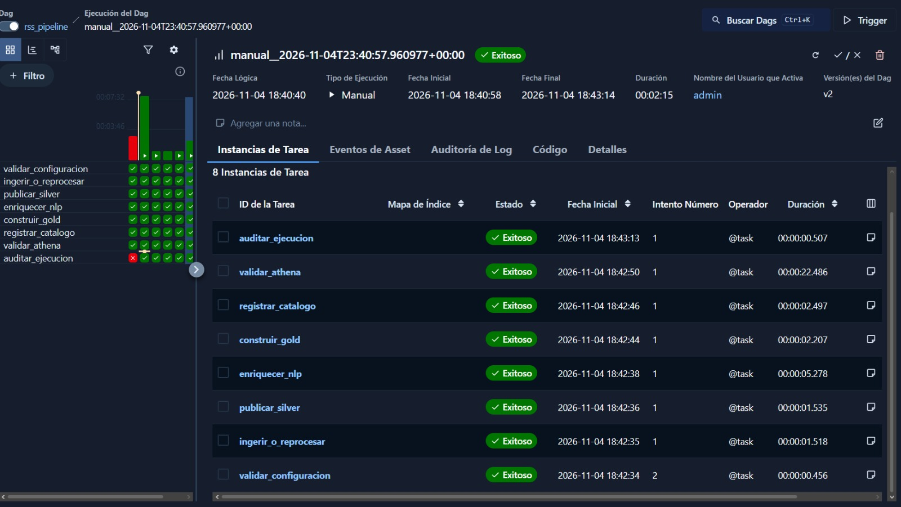

El grafo muestra las dependencias explícitas y la ruta de auditoría ante fallos:

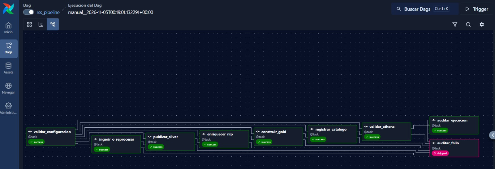

El manifiesto Bronze demuestra que las tres fuentes terminaron correctamente, con 30 registros, hashes y rutas inmutables en S3:

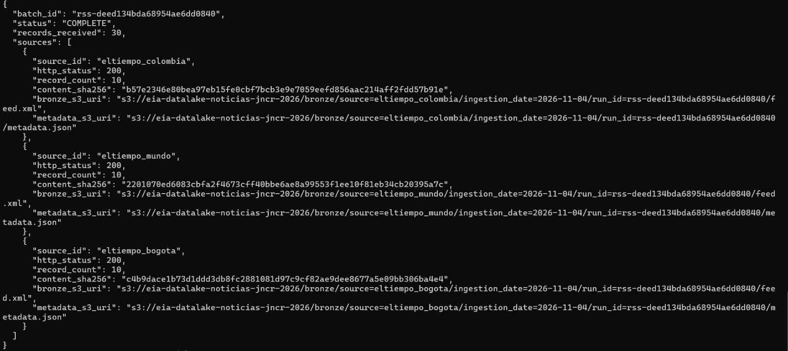

## 2. Consulta de indicadores en Athena

La consulta de noticias por fecha y sección se ejecutó sobre las tablas catalogadas:

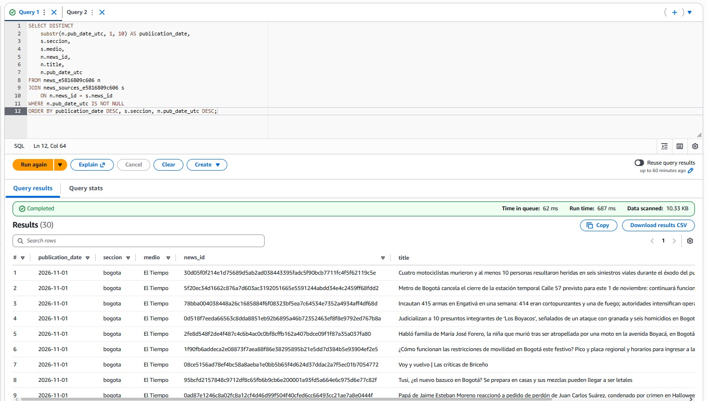

También se verificaron las organizaciones más frecuentes y la conciliación Gold contra Silver:

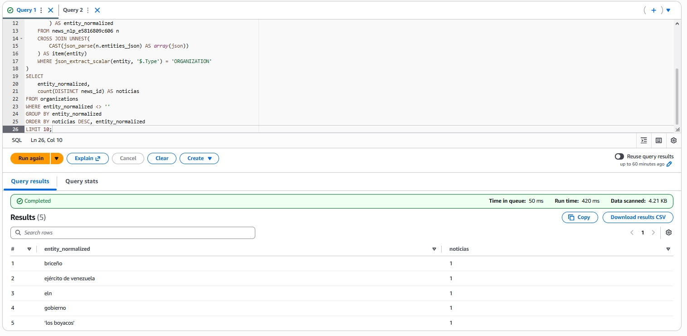

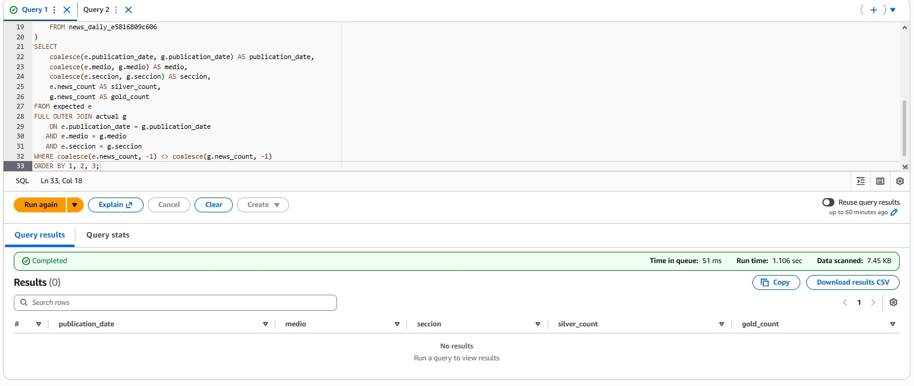

Las consultas reproducibles están en `sql/consultas-athena.sql`.

## 3. Reproceso sin duplicación

El reproceso utiliza un `batch_id` existente y lee los XML de Bronze sin volver a consultar los RSS. La tarea muestra `reused=True` para las tres fuentes:

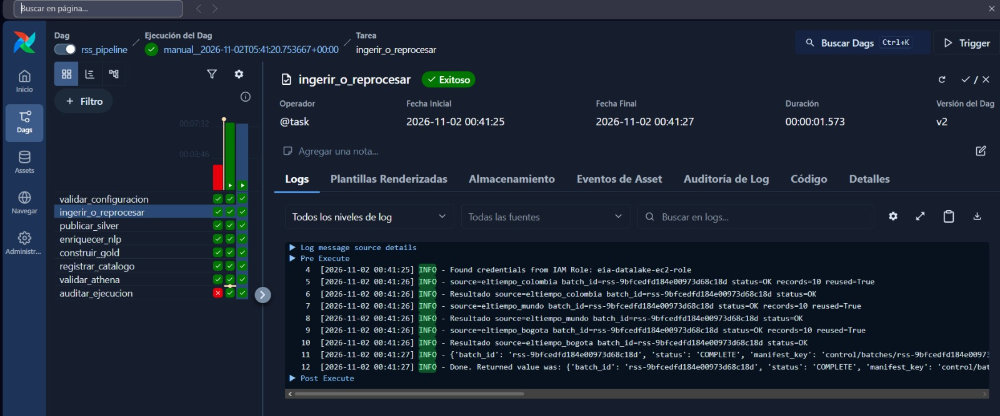

La segunda ejecución de Gold devuelve `reused_release: True`, por lo que no duplica agregados ni publica otra copia lógica:

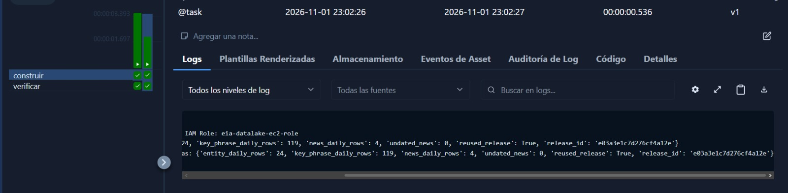

## 4. Fallo controlado y recuperación

Un `batch_id` inexistente produce un error explícito y activa la auditoría de fallo:

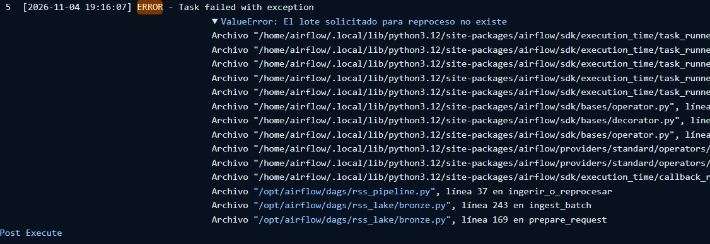

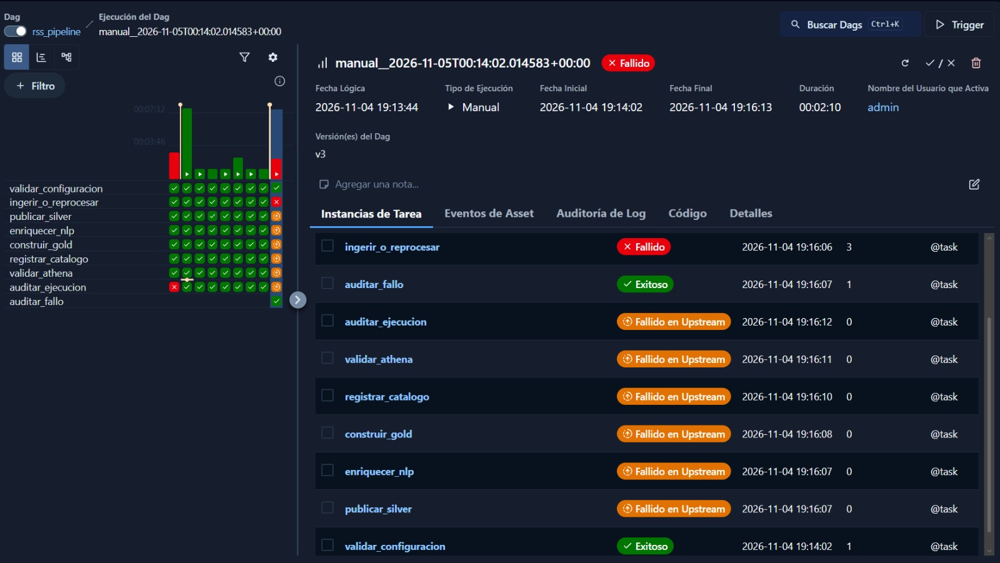

Al corregir el lote y reejecutar, el pipeline termina satisfactoriamente sin pérdida ni duplicación:

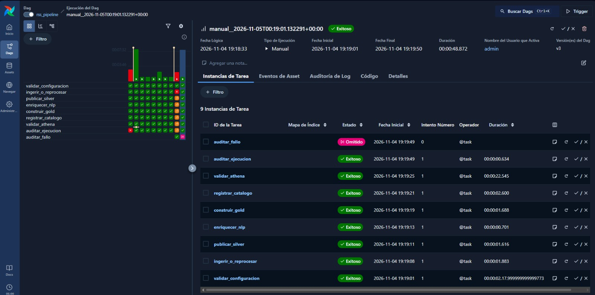

## 5. Limitación del enriquecimiento

Amazon Comprehend identifica menciones de personas, organizaciones y lugares, pero no resuelve identidad ni alias. Por ejemplo, dos formas diferentes de nombrar una organización pueden quedar como entidades separadas. La solución normaliza mayúsculas, espacios y Unicode para las métricas, pero no intenta decidir si nombres distintos representan la misma entidad real.

La caché se identifica por el hash del texto exacto. Si cambia el título o la descripción se ejecuta un nuevo análisis; si el texto no cambia, se reutiliza el resultado persistido:

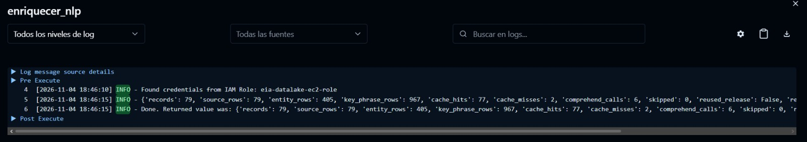

## Resultado

La evidencia demuestra carga completa, consumo analítico, idempotencia, reproceso desde Bronze, recuperación ante fallos y una limitación conocida del procesamiento de lenguaje natural. Para una sustentación en vivo se pueden repetir los mismos pasos usando las configuraciones descritas en `docs/DESPLIEGUE.md`.
